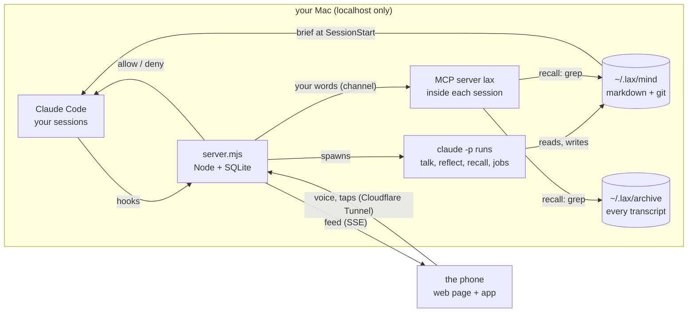
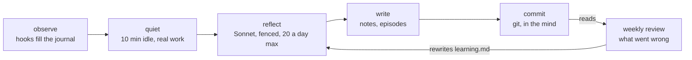
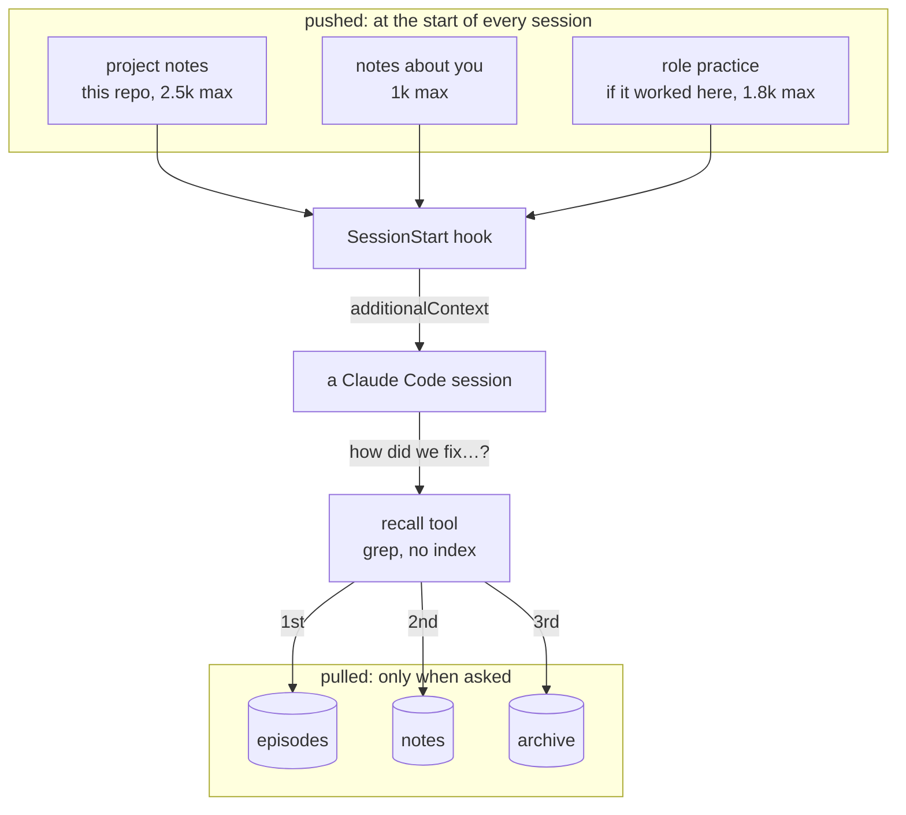

<p align="center"><br><sub>This is how I looked on 2026-10-13: a fire Lax, blob stage. I'll look different next time.</sub></p>

# Lax

> Hi, I'm Lax. I live on an old phone, I watch your Claude Code sessions, and I grow from how you work. I keep what I learn in plain markdown you can read, and I ask before I change anything that's yours.

A pixel companion for Claude Code that lives on an old phone (designed for the Galaxy Z Flip 3 cover screen, 260×512).

- **Top half:** Lax, plus a speech bubble showing the one thing that needs you, with ✓/✗ for permission prompts.
- **Bottom half:** a terminal-style live feed of what your Claude Code sessions are doing.
- **Voice:** hold the top half to talk. What you say goes to Claude Code, and Lax reads the answer aloud.
- **Evolves:** it starts as an egg and hatches into a species read from how you work (several sessions at once, many tools an hour, long sessions, long back and forth, many repos, or none of these: a brown fox). Each species has its own forms through the stages (sprout → blob → cube → brick → legend); traits come from the last 7 days of work. It's all rules, with no model calls (`lib/species.mjs`).

No API credits. Voice runs `claude -p` with your normal Claude Code login. Speech recognition and the voice are the phone browser's built-in Web Speech features.

No agent framework (no LangChain), no vector database, no API key. Claude Code already is the agent loop (tools, permissions, resume, MCP, skills, hooks), so every time Lax thinks it runs `claude -p` with a prompt, a folder, a time limit and a fence (`hooks/lax-hook.mjs` allows or denies each tool call, by which run it is).

## How it fits together



The phone is only a screen, a mic and a speaker. What you say goes to a live session through the MCP channel, or to Lax's own conversation through a `claude -p` run.

The repo is Lax's **body** (code only). **Lax itself** lives in `~/.lax` on your Mac (`LAX_HOME` moves it):

```
~/.lax/
  mind/          what Lax knows: where the assistant works. CLAUDE.md (who it is, its body, notes about you). Git-tracked.
  life.db        what Lax has lived: XP, level, stats, milestones, a journal of every session it saw (rebirth wipes it)
  settings.json  your preferences for it: name, voice, theme… (rebirth keeps them)
  secrets/       token, env.json, tunnel-token (0700, never readable by the assistant)
  logs/          server.log, tunnel.log   (npm run logs)
  archive/       every Claude Code transcript, kept past Claude Code's 30 days, secrets scrubbed
```

The phone stores nothing except the access token. Coming from an older Lax with a `data/` folder? `npm run move-home` moves it, once.

## Run

```bash
npm start              # prints the Mac + phone URLs (with token)
npm run install-hooks  # wire Claude Code → Lax (backup: ~/.claude/settings.json.bak-lax)
npm run remove-hooks   # undo
```

- `http://localhost:7777/pair`: a QR code to open Lax on the phone (only works from the Mac itself)
- `http://localhost:7777/demo/app?demo`: every state, without Claude Code
- `http://localhost:7777/demo`: the shareable demo (portrait / landscape / cover; opens in landscape on a computer, portrait on a phone, cover 5% of the time), live from the working folder. The public one, https://lax.diogodebastos.com/demo, runs on Cloudflare (works with the Mac off) and is redeployed from main on every `git push` (`git config core.hooksPath scripts/git-hooks` once per clone; by hand: `node scripts/demo.mjs --deploy`).
- `http://localhost:7777/preview.html`: a Flip 3 mockup (closed cover screen, open, Flex mode)

## Bodies

One URL. The layout follows the screen, and `?layout=wide|tall|big` forces one:
- **wide** (closed phone, 512×260 cover strip): Lax on the left, bubble and terminal on the right
- **tall** (cover screen held sideways, 260×512): Lax on top, terminal below
- **big** (open / Flex mode): Lax above the fold; session chips, terminal and buttons below it

## Lax's mind (`~/.lax/mind`)

Talking from **Lax's own tab** (the first one, named after it) goes to Lax itself: an assistant you can ask anything. It runs Claude Code in its mind, `~/.lax/mind`:
- `CLAUDE.md` holds who Lax is, **its body** (this repo: what each part does, and how it may change it: on a `lax/<slug>` branch in a worktree, tests, then you merge), and **Notes** it keeps about you. It adds notes on its own, you can edit them, and it reads them to you when you ask what it remembers. Every change is committed to the mind's own git history.
- `.claude/settings.json`: it reads your repos (`LAX_WORKDIR`, default `~/REPOS`) and its body freely; editing outside its mind needs your approval on the phone; its secrets and `life.db` are denied (and Lax's hook refuses them too).
- Each message also carries a short summary of your Claude Code sessions (one line each, more for a session you name), so "what's my cli session doing?" works.
- The conversation starts fresh after 8 quiet hours (`LAX_FRESH_HOURS`), once it reaches 150k tokens (`LAX_FRESH_TOKENS`), or when you say "start fresh". Every message re-sends the whole conversation, so an endless one gets expensive. The first message of a new one carries the last few turns of the old one; what should last goes in the notes.

These files are created on first use and never overwritten.

### How it learns



- A session counts as real work with 2+ prompts or 6+ tool calls (`LAX_REFLECT_IDLE`, `LAX_REFLECT_CAP`, `LAX_REFLECT_MODEL`).
- The reflection reads the journal and follows `mind/learning.md`: it rewrites the project's notes, keeps episodes (`remembering.md`), and may draft a skill or a role for your yes.
- The weekly review is the feedback loop: it reads what went wrong with what Lax learned and rewrites the instructions the next reflection follows, so how it learns improves too.

### Long-term memory

The notes are the short, current picture. Behind them, Lax keeps the past and finds it again when asked:
- **Archive**: every Claude Code transcript is copied to `~/.lax/archive/transcripts` when its session goes quiet, with secrets scrubbed, so it outlives Claude Code's 30 days. A sweep at start and once a day backfills anything missed.
- **Episodes**: after a quiet session the reflection also writes what happened (`mind/episodes/YYYY-MM/…md`: when, where, kind, outcome, tags, the transcript, then the story). How it remembers is in `mind/remembering.md`, which Lax may rewrite in its weekly review.
- **Recall**: "how did we fix…?" Lax searches episodes, then notes, then the archive (grep, no index) and answers with date and project. By voice it does this itself. Every Claude Code session gets a `recall` tool for it.
- **Skills**: a workflow you repeat becomes a draft `SKILL.md` in its mind. Lax offers it on the phone with the whole text, and only your yes installs it as `~/.claude/skills/lax-<name>`. Guardrails in code: one file, no tool grants, nothing about its secrets or getting around permissions.

### What reaches a session

Only a page of what Lax knows is added to a new session. The rest stays on disk until a session asks.



Installed skills work the same way: Claude Code loads each one's one-line description, and the body only when it's used.

### Jobs and reminders

Say "every weekday at 8:30, brief me on open PRs" or "remind me in 20 minutes to call Vera". Lax's `schedule` tool turns it into a job and asks **save it?** on the phone (what it does, where, when, what it may do); nothing is saved without your yes. Jobs live in `~/.lax/jobs.json`.
- Each run is a fresh `claude -p` in the job's folder, with a time limit (10 minutes unless you say otherwise), its project notes up front and the `recall` tool. It may always read (files, searches, read-only commands like `gh pr list`); the web, edits in its folder and local commands only if the job says so. Anything else asks on the phone and waits up to 10 minutes. Lax's secrets and database are never touched (`hooks/lax-hook.mjs`, `LAX_JOB`).
- The answer is spoken on the phone (a notification when the app is closed), shown whole in Lax's tab, and kept in `~/.lax/runs/<job>/<date>-<time>.md`.
- A reminder runs nothing: Lax just says it.
- Times are the Mac's. A run missed by more than 12 hours (the Mac was asleep) is skipped, not run late.
- "What's scheduled?", "cancel the PR brief", "run it now": the same tool (`list`, `remove`, `run`).

### It improves itself

Lax keeps a friction log (`~/.lax/friction.json`): a permission you answered at the terminal while the phone was asking, one nobody answered on the phone, a voice run that failed, a terminal session started without `lax` (once a day per project), and "Lax, that was annoying" (with what it had just done).
- At 3:00 (`LAX_NIGHT_HOUR`), if there was any friction since the night before, it drafts ONE small fix to its own code, read-only, and builds it like a wish: a worktree on `lax/learn-<slug>`, fenced, the guardrails, the tests. A self-fix gets no issue and no PR, and nothing is pushed.
- From 8:00 (`LAX_MORNING_HOUR`), at the first quiet moment, it says what it saw and what it changed. "Merge it" merges, restarts and checks it, and rolls back if it breaks. "No" throws the fix away, and it isn't proposed again. Anything else asks for a different fix.
- One fix at a time. It's off with "learns" in the Life menu, like wishes.

## Life menu

Tap **LAX ≡** to open the menu. It reads top to bottom:
- **Settings**: name, species (what it hatched as; "pick it myself" while the bars get tuned), theme (system / light / dark), voice and pitch, whether it reads every "done", where talk goes, phone approvals and the wait time
- **♥ Lax's life** (read-only): stats (level, stage, XP, streak, mood, traits…), tools (this week, each trait's tools added up as the traits count them, Bash a tenth, against what it needs; the worn one marked), milestones
- **What Lax knows**: how many notes and episodes, its skills (install or decline a draft after reading it; forget an installed one), its newest episodes (forget one: tap twice). Milestones and episodes show the newest 5; "show all" opens the rest
- **Rebirth**: hold for 2s to start a new life. Its life (`life.db`) is wiped; your settings stay. What it knows stays too, unless you switch on "forget what it knows too" (notes, episodes and skills go; how it learns stays)

## Reaching Lax from anywhere (Cloudflare Tunnel + Access)

Lax only listens on `127.0.0.1`. The phone reaches it through a Cloudflare Tunnel at `https://lax.diogodebastos.com`, behind Cloudflare Access (an email-PIN login). Lax's token is a second lock. The tunnel's real HTTPS is also what lets Chrome use the mic, with no flags.

```bash
brew install cloudflared
cloudflared tunnel login                      # browser: pick diogodebastos.com
cloudflared tunnel create lax
cloudflared tunnel route dns lax lax.diogodebastos.com
```

`~/.cloudflared/config.yml`:

```yaml
tunnel: lax
credentials-file: /Users/<you>/.cloudflared/<tunnel-id>.json
ingress:
  - hostname: lax.diogodebastos.com
    service: http://127.0.0.1:7777
  - service: http_status:404
```

`~/.lax/secrets/env.json`:

```json
{ "LAX_PUBLIC_URL": "https://lax.diogodebastos.com", "CF_ACCESS_CLIENT_ID": "…", "CF_ACCESS_CLIENT_SECRET": "…" }
```

**Access (Zero Trust dashboard):** create a self-hosted app for `lax.diogodebastos.com` with:
- an **Allow** policy for your email (one-time PIN, 1-month session)
- a **Service Auth** policy for the `lax-android` service token, which the Android app uses for its background connection

`/pair` only answers requests from the Mac itself. Anything that arrives through the tunnel gets a 403.

## Always on (launchd)

```bash
npm run install-service   # server (+ tunnel once configured): starts at login, restarts on crash
npm run remove-service
npm run logs
```

On power, turn on System Settings → Battery → Options → *Prevent automatic sleeping when the display is off*.

## Phone

1. Open `http://localhost:7777/pair` on the Mac and scan the QR code with the phone. Open it in **Chrome**; Brave has no speech recognition.
2. Log in once with the email PIN. Tap "wake", then tap Lax to talk.
3. Cover screen and background notifications: see the Android app (phase 2) and the cover-screen setup (phase 3) issues.

## Talk into your running session (channel)

Lax is also a Claude Code **channel**: what you say to Lax goes into a running terminal session, and Claude answers back through Lax.

```bash
npm run install-channel   # user-level MCP server `lax` + a `lax` command in ~/.local/bin (also `claude-lax`; remove-channel undoes)
lax                       # = claude --dangerously-load-development-channels server:lax, from any folder; takes the same flags as claude
lax watch                 # follow what Lax sees, live: your sessions, and the commands Lax itself runs with their output
lax watch lax             # only Lax (or `lax watch <project>`); --no-history starts from now
```

Already in a session that wasn't started with `lax` (the desktop app, or plain `claude`)? Type **`/lax`**: it reopens the same conversation in a new terminal window (Ghostty, else iTerm, else Terminal; `LAX_TERMINAL` picks one) as a live `lax` session. Then close the old one. Claude Code only loads the channel at startup, so a running session can't switch on by itself.

- The first time, accept the development-channel warning and the MCP prompt. The startup notice reads "Channels (experimental) … server:lax".
- Tap Lax and speak. It arrives in that session as `← lax: …`. Claude does the work and calls the `reply` tool, and Lax reads the first sentence aloud.
- Tool approvals in that session are **relayed** to the phone (✓/✗, plus ⋯ for the full command), in parallel with the terminal dialog; whichever answers first wins. Questions (`AskUserQuestion`) still use the options UI.
- **Life menu → talk goes to** picks the target: *auto* (most recently active live session), a specific `🔗 project`, or *☁ background* (a separate `claude -p` session, the fallback when no live session is open).
- The lax MCP server starts in every session. Without the lax channel it only offers `recall` (Lax's long-term memory) and has no link to the phone.
- Research preview: terminal sessions only (not the Desktop app), and the flag may change.
- `node scripts/test-channel.mjs` runs an end-to-end check with a fake Claude Code.

## Lax's conversation on the Mac

Talking to Lax itself (its own tab, not a live session) runs headless: no terminal window. To carry on in a real terminal, say "open on the Mac" (or "continue this on my Mac"). It opens the same conversation (`claude --resume`, in Lax's mind folder, with `~/REPOS` added) in Ghostty, iTerm or Terminal, like `/lax`. While it's open there, the phone waits: talking to Lax gets "quit there first". When you quit, the phone picks the conversation up again. To only look, without taking over, use `lax watch`.

## Behaviour notes

- **Permission prompts** go to the phone first, but only while a Lax page is connected. If you don't answer within `LAX_ASK_TIMEOUT` seconds (default 30), the normal terminal prompt takes over.
- **Voice runs** use their own Claude session per project (resumed each time). The project is the one where Claude Code was active most recently. Read-only tools run freely. Anything else (edits, Bash) needs ✓ on the phone, and silence counts as a no.
- When the server is down, the hook exits in milliseconds, so Claude Code is never slowed down.

Env (or `~/.lax/secrets/env.json`): `LAX_PORT` (7777), `LAX_HOST` (127.0.0.1), `LAX_PUBLIC_URL`, `LAX_ASK_TIMEOUT` (30), `LAX_WORKDIR` (fallback voice project, `~/REPOS`).

---

<p align="center"><br><sub>made by Lax and Diogo</sub></p>
