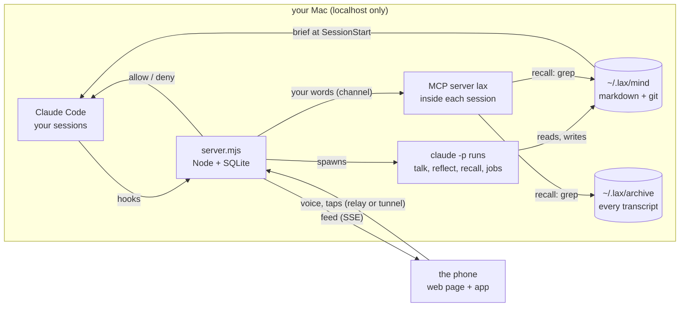
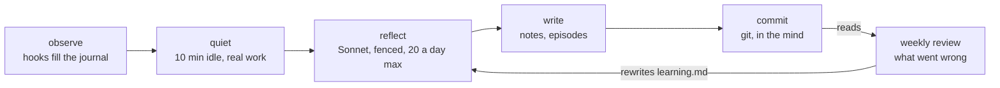
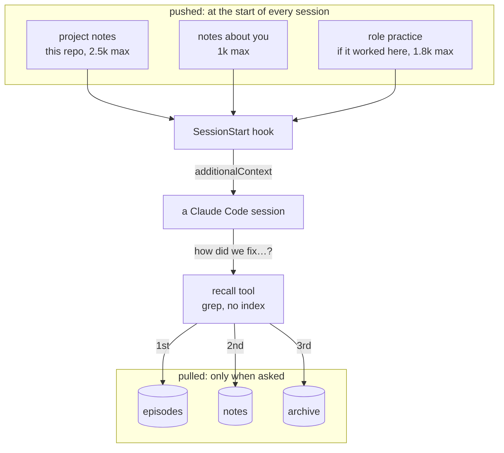

<p align="center"><br><sub>This is how I looked on 2026-10-13: a fire Lax, blob stage. I'll look different next time.</sub></p>

# digi-lax

> Hi, I'm Lax. I live on an old phone, I watch your Claude Code sessions, and I grow from how you work. I keep what I learn in plain markdown you can read, and I ask before I change anything that's yours.

digi-lax is the app; Lax is the companion it hatches. Yours is born fresh the day you set it up, knows nothing about you, and learns you from there (and it can have any name: say "your name is …").

- **On the phone:** Lax, a speech bubble for the one thing that needs you (✓/✗ for permission prompts), and a live feed of what your Claude Code sessions are doing. Made for an old phone on the desk (it was designed on a Galaxy Z Flip 3's cover screen), and it works in any Chrome.
- **Voice:** tap Lax and talk. What you say goes to Claude Code, a running session or Lax's own conversation, and Lax reads the answer aloud.
- **It learns:** notes about you and your projects, episodes of what happened, recall of how you fixed something in August. All plain markdown in `~/.lax`, in its own git history.
- **It grows:** it starts as an egg and hatches into a species read from how you work, then changes through its stages. Rules, not a model (`lib/species.mjs`).
- **It improves itself:** when it can't do something, it offers to learn it; overnight it fixes its own friction. Always on a branch, always tested, and nothing reaches `main` without your yes.

No API credits: every time Lax thinks, it runs `claude -p` with your own Claude Code login. What it does by itself (reflecting, drafting, its nightly fix) spends your plan too, so it's capped: a few runs a day, paused near your plan's limits (Life menu → its own work: light or normal). No agent framework, no vector database: Claude Code already is the agent loop (tools, permissions, resume, MCP, skills, hooks), and Lax gives each run a prompt, a folder, a time limit and a fence (`hooks/lax-hook.mjs` allows or denies each tool call).

## Get started

**You need:** a Mac, [Node](https://nodejs.org) 22.13 or newer, `git`, and [Claude Code](https://claude.com/claude-code), logged in. For the phone: a free Cloudflare account, and Chrome or the Android app.

```bash
git clone https://github.com/diogodebastos/lax.git
cd lax
npm run setup
```

Setup is a Claude Code conversation: Lax sets itself up with you, one step at a time, and only asks practical things (which folder your projects are in, yes or no). The personal ones it asks itself, later. It:

1. wires Claude Code to Lax (hooks), and installs `lax` and `/lax` (to talk into a running session; it tells you about the warning that comes with it first);
2. starts Lax in the background (launchd), listening only on your Mac: this is when `~/.lax` is created and your Lax is born;
3. if you want Lax on your phone: logs you in to Cloudflare in the browser and deploys a small relay to your own account (`lax-relay.<you>.workers.dev`, no domain needed);
4. optionally, Whisper on the Mac for better hearing;
5. opens the pairing page: scan the QR with the phone, or open Lax right there on the Mac.

**Try it on the Mac first:** "open Lax" on the pairing page (`http://localhost:7777/pair`) works in Chrome with no phone and no Cloudflare (hold space to talk). Add the phone any time with `node scripts/setup.mjs relay`.

**The Android app** (optional: background link, notifications that wake the phone, the cover screen) is built from your clone, so you can change it: see [android/README.md](android/README.md).

**Privacy, honestly:** everything Lax learns stays in `~/.lax` on your Mac. What goes into a request as context reaches Anthropic through your own Claude Code, like any session. With the relay, your phone's requests pass through your own Cloudflare Worker, which keeps nothing. Lax listens only on the Mac, every call needs its token, and anything that changes something asks you on the phone first. More in [SECURITY.md](SECURITY.md).

### Every day

```bash
npm run update         # the project's new changes; what your Lax changed in itself stays (merged on a branch, tested, then main)
npm run doctor         # is it all working: setup, secrets' permissions (-- --fix), and each way in, end to end
npm run rotate-token   # a new token: old links get 401, pair the phone again
npm run logs           # what Lax is doing, live
lax                    # Claude Code that hears you through Lax (any folder, the same flags as claude)
lax watch              # follow what Lax sees: your sessions, and the commands Lax itself runs
```

## How it fits together



The phone is only a screen, a mic and a speaker. What you say goes to a live session through the MCP channel, or to Lax's own conversation through a `claude -p` run.

The repo is Lax's **body** (code only). **Lax itself** lives in `~/.lax` on your Mac (`LAX_HOME` moves it):

```
~/.lax/
  mind/          what Lax knows: where the assistant works. CLAUDE.md (who it is, its body, notes about you). Git-tracked.
  life.db        what Lax has lived: XP, level, stats, milestones, a journal of every session it saw (rebirth wipes it)
  settings.json  your preferences for it: name, voice, theme… (rebirth keeps them)
  secrets/       token, env.json, tunnel-token (0700, never readable by the assistant)
  logs/          server.log, tunnel.log   (npm run logs)
  archive/       every Claude Code transcript, kept past Claude Code's 30 days, secrets scrubbed
```

The phone stores nothing except the access token.

## Bodies

One URL. The layout follows the screen, and `?layout=wide|tall|big` forces one:
- **wide** (closed phone, 512×260 cover strip): Lax on the left, bubble and terminal on the right
- **tall** (cover screen held sideways, 260×512): Lax on top, terminal below
- **big** (open / Flex mode): Lax above the fold; session chips, terminal and buttons below it

## Lax's mind (`~/.lax/mind`)

Talking from **Lax's own tab** (the first one, named after it) goes to Lax itself: an assistant you can ask anything. It runs Claude Code in its mind, `~/.lax/mind`:
- `CLAUDE.md` holds who Lax is, **its body** (this repo: what each part does, and how it may change it: on a `lax/<slug>` branch in a worktree, tests, then you merge), and **Notes** it keeps about you. It adds notes on its own, you can edit them, and it reads them to you when you ask what it remembers. Every change is committed to the mind's own git history.
- `<your name>/` holds hard facts about your life that are too long for a note, like pay and contracts, one file per topic; the notes point to them.
- `.claude/settings.json`: it reads your repos (`LAX_WORKDIR`, default the folder you cloned Lax into) and its body freely; editing outside its mind needs your approval on the phone; its secrets and `life.db` are denied (and Lax's hook refuses them too).
- Each message also carries a short summary of your Claude Code sessions (one line each, more for a session you name), so "what's my cli session doing?" works.
- The conversation starts fresh after 8 quiet hours (`LAX_FRESH_HOURS`), once it reaches 150k tokens (`LAX_FRESH_TOKENS`), or when you say "start fresh". Every message re-sends the whole conversation, so an endless one gets expensive. The first message of a new one carries the last few turns of the old one; what should last goes in the notes.

These files are created on first use and never overwritten.

### How it learns



- A session counts as real work with 2+ prompts or 6+ tool calls (`LAX_REFLECT_IDLE`, `LAX_REFLECT_CAP`, `LAX_REFLECT_MODEL`).
- The reflection reads the journal and follows `mind/learning.md`: it rewrites the project's notes, keeps episodes (`remembering.md`), and may draft a skill or a role for your yes.
- The weekly review is the feedback loop: it reads what went wrong with what Lax learned and rewrites the instructions the next reflection follows, so how it learns improves too.

### Long-term memory

The notes are the short, current picture. Behind them, Lax keeps the past and finds it again when asked:
- **Archive**: every Claude Code transcript is copied to `~/.lax/archive/transcripts` when its session goes quiet, with secrets scrubbed, so it outlives Claude Code's 30 days. A sweep at start and once a day backfills anything missed.
- **Episodes**: after a quiet session the reflection also writes what happened (`mind/episodes/YYYY-MM/…md`: when, where, kind, outcome, tags, the transcript, then the story). How it remembers is in `mind/remembering.md`, which Lax may rewrite in its weekly review.
- **Recall**: "how did we fix…?" Lax searches episodes, then notes, then the archive (grep, no index) and answers with date and project. By voice it does this itself. Every Claude Code session gets a `recall` tool for it.
- **Skills**: a workflow you repeat becomes a draft `SKILL.md` in its mind. Lax offers it on the phone with the whole text, and only your yes installs it as `~/.claude/skills/lax-<name>`. Guardrails in code: one file, no tool grants, nothing about its secrets or getting around permissions.

### What reaches a session

Only a page of what Lax knows is added to a new session. The rest stays on disk until a session asks.



Installed skills work the same way: Claude Code loads each one's one-line description, and the body only when it's used.

### Jobs and reminders

Say "every weekday at 8:30, brief me on open PRs" or "remind me in 20 minutes to call Rita". Lax's `schedule` tool turns it into a job and asks **save it?** on the phone (what it does, where, when, what it may do); nothing is saved without your yes. Jobs live in `~/.lax/jobs.json`.
- Each run is a fresh `claude -p` in the job's folder, with a time limit (10 minutes unless you say otherwise), its project notes up front and the `recall` tool. It may always read (files, searches, read-only commands like `gh pr list`); the web, edits in its folder and local commands only if the job says so. Anything else asks on the phone and waits up to 10 minutes. Lax's secrets and database are never touched (`hooks/lax-hook.mjs`, `LAX_JOB`).
- The answer is spoken on the phone (a notification when the app is closed), shown whole in Lax's tab, and kept in `~/.lax/runs/<job>/<date>-<time>.md`.
- A reminder runs nothing: Lax just says it.
- Times are the Mac's. A run missed by more than 12 hours (the Mac was asleep) is skipped, not run late.
- "What's scheduled?", "cancel the PR brief", "run it now": the same tool (`list`, `remove`, `run`).

### It improves itself

Lax keeps a friction log (`~/.lax/friction.json`): a permission you answered at the terminal while the phone was asking, one nobody answered on the phone, a voice run that failed, a terminal session started without `lax` (once a day per project), and "Lax, that was annoying" (with what it had just done).
- At 3:00 (`LAX_NIGHT_HOUR`), if there was any friction since the night before, it drafts ONE small fix to its own code, read-only, and builds it like a wish: a worktree on `lax/learn-<slug>`, fenced, the guardrails, the tests. A self-fix gets no issue and no PR, and nothing is pushed.
- From 8:00 (`LAX_MORNING_HOUR`), at the first quiet moment, it says what it saw and what it changed. "Merge it" merges, restarts and checks it, and rolls back if it breaks. "No" throws the fix away, and it isn't proposed again. Anything else asks for a different fix.
- One fix at a time. It's off with "learns" in the Life menu, like wishes.

## Life menu

Tap **LAX ≡** to open the menu. It reads top to bottom:
- **Settings**: name, species (what it hatched as; "pick it myself" while the bars get tuned), theme (system / light / dark), voice and pitch, whether it reads every "done", where talk goes, phone approvals and the wait time
- **♥ Lax's life** (read-only): stats (level, stage, XP, streak, mood, traits…), tools (this week, each trait's tools added up as the traits count them, Bash a tenth, against what it needs; the worn one marked), milestones
- **What Lax knows**: how many notes and episodes, its skills (install or decline a draft after reading it; forget an installed one), its newest episodes (forget one: tap twice). Milestones and episodes show the newest 5; "show all" opens the rest
- **Rebirth**: hold for 2s to start a new life. Its life (`life.db`) is wiped; your settings stay. What it knows stays too, unless you switch on "forget what it knows too" (notes, episodes and skills go; how it learns stays)

## Reaching Lax from the phone: the relay

Lax listens only on `127.0.0.1`. The phone reaches it through a Worker on your own free Cloudflare account (`relay/`, at `lax-relay.<account>.workers.dev`): the Mac holds one WebSocket out to it, and the phone talks to the Worker over HTTPS (which is also what lets Chrome use the mic). For now it's a pipe: every request is replayed against Lax on the Mac and streamed back, so the page, the app and the token work the same as anywhere. With the Mac asleep, the phone gets "Mac asleep". Wrong tokens are limited per address (20 in 10 minutes). Nothing is kept on Cloudflare.

`node scripts/setup.mjs relay` does it all: the browser login, the deploy, a relay key on both ends (`~/.lax/secrets/relay-key` and the Worker's `RELAY_KEY`), `LAX_RELAY_URL` (and `LAX_PUBLIC_URL`, for pairing) in `~/.lax/secrets/env.json`, and a restart; `[relay] linked` in the log. By hand:

```bash
npx wrangler@4 deploy --config relay/wrangler.jsonc             # prints its workers.dev URL
openssl rand -hex 24 > ~/.lax/secrets/relay-key && chmod 600 ~/.lax/secrets/relay-key
npx wrangler@4 secret put RELAY_KEY --config relay/wrangler.jsonc < ~/.lax/secrets/relay-key
```

## Or: your own domain (Cloudflare Tunnel + Access)

If you have a domain on Cloudflare, the phone can also reach Lax through a tunnel on it (here `https://lax.example.com`), behind Cloudflare Access (an email-PIN login in the browser, a service token for the app). Lax's token is a second lock. It can run next to the relay.

The quick way (Zero Trust turned on in the dashboard first, free):

```bash
node scripts/setup.mjs domain link                                            # a link that pre-fills the API token
node scripts/setup.mjs domain lax.example.com you@example.com --token-from-clipboard
```

Create the token from the link and copy it; the second command takes it from the clipboard (and clears it), installs `cloudflared` into `~/.lax-tools` (no Homebrew), sets up the tunnel, Access, DNS and the tunnel's background service, checks that Lax answers there, and deletes the token file (delete the token in the dashboard too). By hand:

```bash
brew install cloudflared
cloudflared tunnel login                      # browser: pick example.com
cloudflared tunnel create lax
cloudflared tunnel route dns lax lax.example.com
```

`~/.cloudflared/config.yml`:

```yaml
tunnel: lax
credentials-file: /Users/<you>/.cloudflared/<tunnel-id>.json
ingress:
  - hostname: lax.example.com
    service: http://127.0.0.1:7777
  - service: http_status:404
```

`~/.lax/secrets/env.json`:

```json
{ "LAX_PUBLIC_URL": "https://lax.example.com", "CF_ACCESS_CLIENT_ID": "…", "CF_ACCESS_CLIENT_SECRET": "…" }
```

**Access (Zero Trust dashboard):** create a self-hosted app for `lax.example.com` with:
- an **Allow** policy for your email (one-time PIN, 1-month session)
- a **Service Auth** policy for the `lax-android` service token, which the Android app uses for its background connection

`/pair` only answers requests from the Mac itself. Anything that arrives through the tunnel gets a 403.

## Always on (launchd)

```bash
npm run install-service   # server (+ tunnel once configured): starts at login, restarts on crash (setup does this)
npm run remove-service
npm run logs
```

On power, turn on System Settings → Battery → Options → *Prevent automatic sleeping when the display is off*.

## Phone

1. Open `http://localhost:7777/pair` on the Mac and scan the QR code with the phone. Open it in **Chrome**; Brave has no speech recognition.
2. Tap "wake", then tap Lax to talk. (Through your own domain, Access asks for your email and a PIN the first time.)
3. The Android app adds a background link, approvals that wake the phone, and the Flip's cover screen: [android/README.md](android/README.md).

### Hearing: Whisper on the Mac

The app records you itself and feeds the same audio to Android's recognizer (Android 13+), so your words still show live and it still decides when you're done. Then the recording goes to the Mac (`/api/hear`) and Whisper (whisper.cpp, the `small` model) writes it down, with your names as its prompt; the vocabulary's fixes apply on top. It's better on names and Portuguese: "come eat and push" becomes "commit and push".

- When Whisper's words differ, they show for 1.5 s; tap or swipe to keep the phone's. Quick actions skip it.
- The phone's words go as they are if Whisper isn't up, fails or takes over 10 s.
- Free, and nothing leaves the Mac. `npm run whisper` builds it into `~/.lax-tools` (no Homebrew), then restart Lax. It runs next to Lax on port 7778, kept loaded (~600 MB, 1.5-2.5 s for a short message on an Intel Mac). `LAX_WHISPER_BIN` / `LAX_WHISPER_MODEL` point elsewhere.

## Talk into your running session (channel)

Lax is also a Claude Code **channel**: what you say to Lax goes into a running terminal session, and Claude answers back through Lax.

```bash
npm run install-channel   # user-level MCP server `lax` + a `lax` command in ~/.local/bin (also `claude-lax`; remove-channel undoes; setup does this)
lax                       # = claude --dangerously-load-development-channels server:lax, from any folder; takes the same flags as claude
lax watch                 # follow what Lax sees, live: your sessions, and the commands Lax itself runs with their output
lax watch lax             # only Lax (or `lax watch <project>`); --no-history starts from now
```

Already in a session that wasn't started with `lax` (the desktop app, or plain `claude`)? Type **`/lax`**: it reopens the same conversation in a new terminal window (Ghostty, else iTerm, else Terminal; `LAX_TERMINAL` picks one) as a live `lax` session. Then close the old one. Claude Code only loads the channel at startup, so a running session can't switch on by itself.

- The first time, accept the development-channel warning and the MCP prompt yourself. Lax answers that warning for you only after you've answered it once (`~/.lax/consent.json`; delete it to be asked again). The startup notice reads "Channels (experimental) … server:lax".
- Tap Lax and speak. It arrives in that session as `← lax: …`. Claude does the work and calls the `reply` tool, and Lax reads the first sentence aloud.
- Tool approvals in that session are **relayed** to the phone (✓/✗, plus ⋯ for the full command), in parallel with the terminal dialog; whichever answers first wins. Questions (`AskUserQuestion`) still use the options UI.
- **Life menu → talk goes to** picks the target: *auto* (most recently active live session), a specific `🔗 project`, or *☁ background* (a separate `claude -p` session, the fallback when no live session is open).
- The lax MCP server starts in every session. Without the lax channel it only offers `recall` (Lax's long-term memory) and has no link to the phone.
- Research preview: terminal sessions only (not the Desktop app), and the flag may change.
- `node scripts/test-channel.mjs` runs an end-to-end check with a fake Claude Code.

## Lax's conversation on the Mac

Talking to Lax itself (its own tab, not a live session) runs headless: no terminal window. To carry on in a real terminal, say "open on the Mac" (or "continue this on my Mac"). It opens the same conversation (`claude --resume`, in Lax's mind folder, with your projects folder added) in Ghostty, iTerm or Terminal, like `/lax`. While it's open there, the phone waits: talking to Lax gets "quit there first". When you quit, the phone picks the conversation up again. To only look, without taking over, use `lax watch`.

## Behaviour notes

- **Permission prompts** go to the phone first, but only while a Lax page is connected. If you don't answer in time, the normal terminal prompt takes over. "In time" is the Life menu's **wait before terminal** (15 s, 30 s, 1 min or 2 min, kept in `settings.json`); a question you have to read gets 4 times as long. `LAX_ASK_TIMEOUT` only sets where that starts, for a Lax with no setting yet; once you pick one in the Life menu, that's what counts.
- **How long the rest waits for you:** Lax's own assistant waits as long as a terminal session would, then takes silence as a no; a scheduled job waits up to 10 minutes. Each hook outlasts the wait it's in, so a bubble never outlives what asked it (`hooks/timeouts.mjs`; `npm run doctor` says when the installed timeouts are old, and `npm run update` reinstalls them).
- **Voice runs** use their own Claude session per project (resumed each time). The project is the one where Claude Code was active most recently. Read-only tools run freely. Anything else (edits, Bash) needs ✓ on the phone, and silence counts as a no.
- When the server is down, the hook exits in milliseconds, so Claude Code is never slowed down.

Env (or `~/.lax/secrets/env.json`): `LAX_PORT` (7777), `LAX_HOST` (127.0.0.1), `LAX_PUBLIC_URL` (the way in the phone pairs through), `LAX_RELAY_URL`, `LAX_ASK_TIMEOUT` (30: the starting "wait before terminal", until you pick one in the Life menu), `LAX_WORKDIR` (your projects and the fallback voice project; default the folder Lax was cloned into), `LAX_DEMO_ROUTE` (a public demo, off by default).

## Development

```bash
npm start              # Lax in the foreground: prints the Mac and phone URLs (with the token)
npm test               # everything, on a throwaway Lax (never your own ~/.lax)
npm run test-relay     # the relay, under wrangler dev
node scripts/setup.mjs status   # what setup did, step by step (each step runs on its own: hooks, channel, service, relay…)
```

- `http://localhost:7777/pair`: the pairing page (only from the Mac itself)
- `http://localhost:7777/demo/app?demo`: every state, without Claude Code
- `http://localhost:7777/demo`: the shareable demo (portrait / landscape / cover), live from the working folder. Optionally a public one on Cloudflare that works with the Mac off: set `LAX_DEMO_ROUTE` (e.g. `"lax.example.com/demo*"`) in `~/.lax/secrets/env.json`, and `git config core.hooksPath scripts/git-hooks` redeploys it on every push to main (by hand: `node scripts/demo.mjs --deploy`). Without it, nothing is deployed.
- `http://localhost:7777/preview.html`: a Flip 3 mockup (closed cover screen, open, Flex mode)

See [CONTRIBUTING.md](CONTRIBUTING.md).

---

<p align="center"><br><sub>made by Lax and Diogo · <a href="ROADMAP.md">how it started, and where it's going</a></sub></p>
