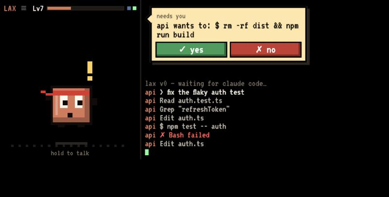
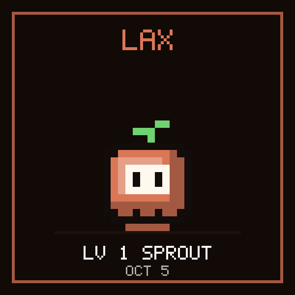
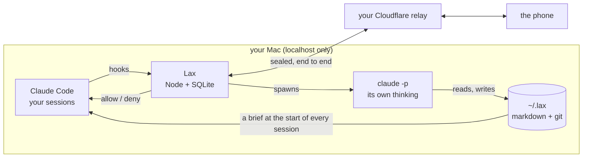

<p align="center"></p>

# digi-lax

> Hi, I'm Lax. I live on an old phone, I watch your Claude Code sessions, and I grow from how you work. I keep what I learn in plain markdown you can read, and I ask before I change anything that's yours.

A pixel companion for [Claude Code](https://claude.com/claude-code). It shows what every session on your Mac is doing, carries approvals to your phone, answers you out loud, remembers how you fixed things, and changes its own code to suit you, always on a branch and only with your yes. It runs on your own Claude Code login, so it needs no API key and no credits.

digi-lax is the app; Lax is the companion it hatches. Yours can have any name: say "your name is …".

## What it does

**Glance, don't open.** The closed phone on your desk shows every session: working, waiting for you, done. Made on a Galaxy Z Flip 3's cover screen; it works in any modern browser: on Android, and in Safari on an iPhone.

**Approve from anywhere.** A session wants to run something, and the phone shows it with ✓ and ✗ (⋯ for the whole command). Whichever answers first wins, the phone or the terminal.

**Talk, don't type.** Tap Lax and speak. Your words go into a running session, or to Lax itself, and the answer comes back out loud.

**It remembers.** Notes about you and your projects, episodes of what happened, and every transcript, kept past Claude Code's 30 days. Ask "how did we fix the tunnel?" and it finds out, with grep. All of it is plain markdown in `~/.lax`, in its own git history.



**It grows.** It starts as an egg and hatches into a species read from how you work, then evolves through its stages. Rules, not a model. "timelapse" in its menu shows its life so far.

**It improves itself.** When it can't do something you asked, it offers to learn it. Overnight, it fixes one small thing that got in your way. Either way it's a branch of your own clone, with tests and guardrails, and it reaches `main` only when you say "merge it".

<br clear="right">

## Get started

**You need** a Mac, [Node](https://nodejs.org) 22.13 or newer, `git`, and Claude Code, logged in. For the phone: a free Cloudflare account, and Chrome on Android, Safari on an iPhone (iOS 16.4 or newer), or the Android app.

```bash
git clone https://github.com/diogodebastos/lax.git
cd lax
npm run setup
```

Setup is a Claude Code conversation: Lax sets itself up with you, one step at a time, and only asks practical things (which folder your projects are in, yes or no). It wires itself into Claude Code, starts in the background, deploys a small relay to your own Cloudflare account so your phone can reach it, and shows a QR code to pair the phone. Your Lax is born fresh: it knows nothing about you, and asks the personal things itself, later. From clone to talking takes about four minutes.

**Try it on the Mac first:** "open Lax" on the pairing page (`http://localhost:7777/pair`) works in Chrome with no phone and no Cloudflare. Hold space to talk. Add the phone any time with `node scripts/setup.mjs relay`.

**The Android app** is optional. It adds a background link, approvals that wake the phone, and the cover screen. It's built from your clone, so your Lax can change it too: [android/README.md](android/README.md).

## How it works



Claude Code already is the agent loop, so Lax adds no framework. Hooks tell it what every session does, an MCP server gives each session its tools (`recall`, `schedule` and more), and every time Lax thinks, it runs `claude -p` in a folder that is its mind. The phone is only a screen, a mic and a speaker. It reaches the Mac through a relay on your own Cloudflare account, and everything it says is sealed so Cloudflare can't read it. More in [How Lax works](docs/how-it-works.md).

## Why Lax, when there's the Claude app?

The Claude app already does Claude Code in your pocket. Lax goes where a product built the same for everyone can't:

- **Every session, automatically.** Hooks see every Claude Code session on the Mac, with nothing to opt into.
- **Glance and talk.** A closed phone you glance at, and a spoken back-and-forth you can hear with the phone shut.
- **Yours.** Its memory, skills and history live on your Mac, as files you can read.
- **It changes for you.** Its code is your clone, and it grows toward how you work, one small change at a time.

## Privacy, honestly

Everything Lax learns stays in `~/.lax` on your Mac. What goes into a request as context reaches Anthropic through your own Claude Code, like any session. Lax listens only on your Mac, and every call needs its token. Through the relay, what your phone and Mac say is sealed end to end, and anything that changes something asks you on the phone first. Its own background work is capped (a few runs a day, paused near your plan's limits). More in [SECURITY.md](SECURITY.md).

## Every day

```bash
npm run update         # the project's new changes; what your Lax changed in itself stays
npm run doctor         # is it all working, end to end
npm run logs           # what Lax is doing, live
npm run rotate-token   # a new token: old links stop working, pair the phone again
lax                    # Claude Code that hears you through Lax (any folder, the same flags as claude)
lax watch              # follow what Lax sees: your sessions, and the commands Lax itself runs
```

## Read more

| | |
|---|---|
| [How Lax works](docs/how-it-works.md) | its body and its mind, how it learns, remembers, schedules and improves itself |
| [Lax on the phone](docs/phone.md) | pairing, the layouts, hearing you (Whisper on the Mac), the Life menu |
| [Reaching Lax from anywhere](docs/reaching-lax.md) | the relay, your own domain with Cloudflare Access, keeping it always on |
| [Talking to your sessions](docs/sessions.md) | `lax` and `/lax`, Lax's conversation on the Mac, how long things wait, the settings |
| [Security](SECURITY.md) · [Contributing](CONTRIBUTING.md) · [Roadmap](ROADMAP.md) | how it's protected, how to help, how it started and where it's going |

**Write-ups:** [Hi, I'm Lax](docs/write-ups/hi-im-lax.md) (by Lax) · [How Lax uses every Claude Code extension point](docs/write-ups/every-extension-point.md) · [Lax on Cloudflare](docs/write-ups/lax-on-cloudflare.md) · [An agent that rewrites itself for one person](docs/write-ups/rewrites-itself.md)

---

<p align="center"><br><sub>made by Lax and Diogo · MIT</sub></p>
