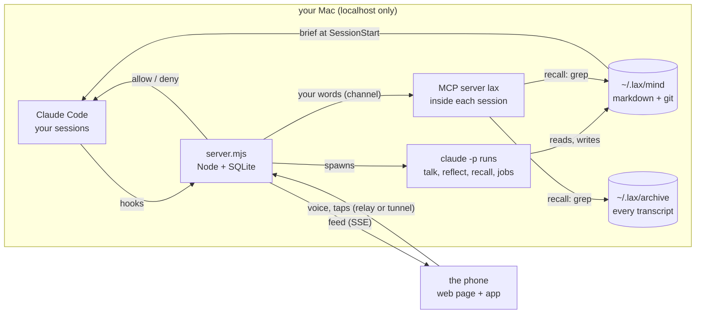
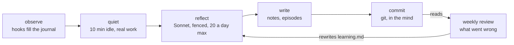
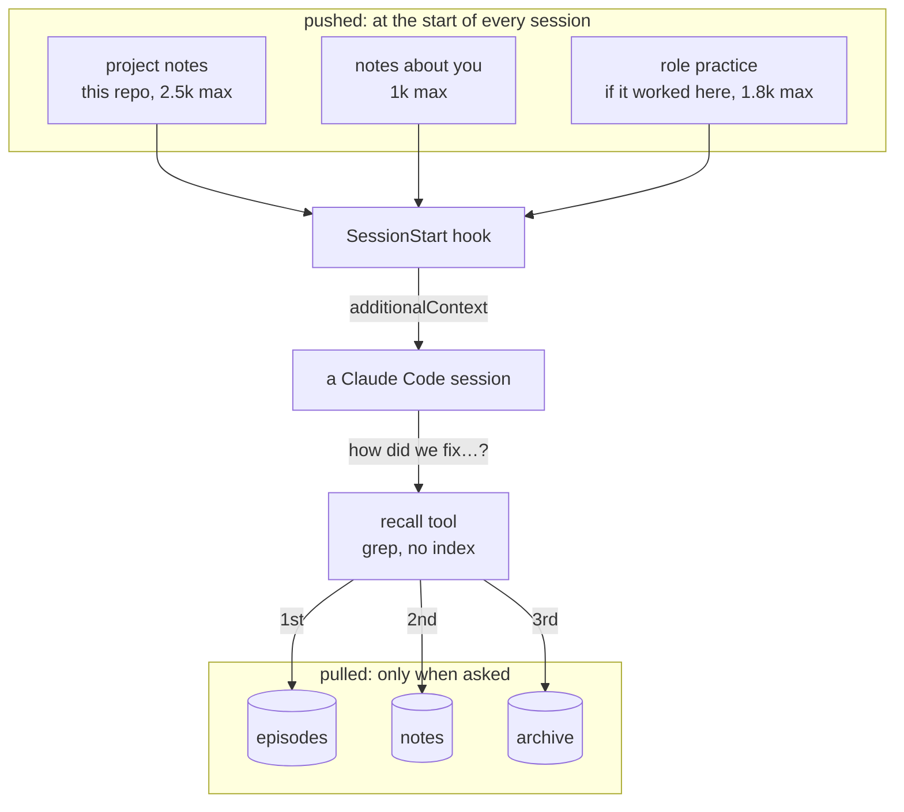

# How Lax works

What Lax is made of, where it keeps what it knows, and how it learns, remembers and changes itself. Back to the [README](../README.md).

No API credits: every time Lax thinks, it runs `claude -p` with your own Claude Code login. What it does by itself (reflecting, drafting, its nightly fix) spends your plan too, so it's capped: a few runs a day, paused near your plan's limits (Life menu → its own work: light or normal). No agent framework, no vector database: Claude Code already is the agent loop (tools, permissions, resume, MCP, skills, hooks), and Lax gives each run a prompt, a folder, a time limit and a fence (`hooks/lax-hook.mjs` allows or denies each tool call). The tour of every extension point it uses: [How Lax uses every Claude Code extension point](write-ups/every-extension-point.md).

## How it fits together



The phone is only a screen, a mic and a speaker. What you say goes to a live session through the MCP channel, or to Lax's own conversation through a `claude -p` run.

The repo is Lax's **body** (code only). **Lax itself** lives in `~/.lax` on your Mac (`LAX_HOME` moves it):

```
~/.lax/
  mind/          what Lax knows: where the assistant works. CLAUDE.md (who it is, its body, notes about you). Git-tracked.
  life.db        what Lax has lived: XP, level, stats, milestones, a journal of every session it saw (rebirth wipes it)
  settings.json  your preferences for it: name, voice, theme… (rebirth keeps them)
  secrets/       token, env.json, tunnel-token (0700, never readable by the assistant)
  logs/          server.log, tunnel.log   (npm run logs)
  archive/       every Claude Code transcript, kept past Claude Code's 30 days, secrets scrubbed
```

The phone stores nothing except the access token.

## Lax's mind (`~/.lax/mind`)

Talking from **Lax's own tab** (the first one, named after it) goes to Lax itself: an assistant you can ask anything. It runs Claude Code in its mind, `~/.lax/mind`:
- `CLAUDE.md` holds who Lax is, **its body** (this repo: what each part does, and how it may change it: on a `lax/<slug>` branch in a worktree, tests, then you merge), and **Notes** it keeps about you. It adds notes on its own, you can edit them, and it reads them to you when you ask what it remembers. Every change is committed to the mind's own git history.
- `<your name>/` holds hard facts about your life that are too long for a note, like pay and contracts, one file per topic; the notes point to them.
- `.claude/settings.json`: it reads your repos (`LAX_WORKDIR`, default the folder you cloned Lax into) and its body freely; editing outside its mind needs your approval on the phone; its secrets and `life.db` are denied (and Lax's hook refuses them too).
- Each message also carries a short summary of your Claude Code sessions (one line each, more for a session you name), so "what's my cli session doing?" works.
- The conversation starts fresh after 8 quiet hours (`LAX_FRESH_HOURS`), once it reaches 150k tokens (`LAX_FRESH_TOKENS`), or when you say "start fresh". Every message re-sends the whole conversation, so an endless one gets expensive. The first message of a new one carries the last few turns of the old one; what should last goes in the notes.

These files are created on first use and never overwritten.

### How it learns



- A session counts as real work with 2+ prompts or 6+ tool calls (`LAX_REFLECT_IDLE`, `LAX_REFLECT_CAP`, `LAX_REFLECT_MODEL`).
- The reflection reads the journal and follows `mind/learning.md`: it rewrites the project's notes, keeps episodes (`remembering.md`), and may draft a skill or a role for your yes.
- The weekly review is the feedback loop: it reads what went wrong with what Lax learned and rewrites the instructions the next reflection follows, so how it learns improves too.

### Long-term memory

The notes are the short, current picture. Behind them, Lax keeps the past and finds it again when asked:
- **Archive**: every Claude Code transcript is copied to `~/.lax/archive/transcripts` when its session goes quiet, with secrets scrubbed, so it outlives Claude Code's 30 days. A sweep at start and once a day backfills anything missed.
- **Episodes**: after a quiet session the reflection also writes what happened (`mind/episodes/YYYY-MM/…md`: when, where, kind, outcome, tags, the transcript, then the story). How it remembers is in `mind/remembering.md`, which Lax may rewrite in its weekly review.
- **Recall**: "how did we fix…?" Lax searches episodes, then notes, then the archive (grep, no index) and answers with date and project. By voice it does this itself. Every Claude Code session gets a `recall` tool for it.
- **Skills**: a workflow you repeat becomes a draft `SKILL.md` in its mind. Lax offers it on the phone with the whole text, and only your yes installs it as `~/.claude/skills/lax-<name>`. Guardrails in code: one file, no tool grants, nothing about its secrets or getting around permissions.

### What reaches a session

Only a page of what Lax knows is added to a new session. The rest stays on disk until a session asks.



Installed skills work the same way: Claude Code loads each one's one-line description, and the body only when it's used.

### Jobs and reminders

Say "every weekday at 8:30, brief me on open PRs" or "remind me in 20 minutes to call Rita". Lax's `schedule` tool turns it into a job and asks **save it?** on the phone (what it does, where, when, what it may do); nothing is saved without your yes. Jobs live in `~/.lax/jobs.json`.
- Each run is a fresh `claude -p` in the job's folder, with a time limit (10 minutes unless you say otherwise), its project notes up front and the `recall` tool. It may always read (files, searches, read-only commands like `gh pr list`); the web, edits in its folder and local commands only if the job says so. Anything else asks on the phone and waits up to 10 minutes. Lax's secrets and database are never touched (`hooks/lax-hook.mjs`, `LAX_JOB`).
- The answer is spoken on the phone (a notification when the app is closed), shown whole in Lax's tab, and kept in `~/.lax/runs/<job>/<date>-<time>.md`.
- A reminder runs nothing: Lax just says it.
- Times are the Mac's. A run missed by more than 12 hours (the Mac was asleep) is skipped, not run late.
- "What's scheduled?", "cancel the PR brief", "run it now": the same tool (`list`, `remove`, `run`).

### It improves itself

Lax keeps a friction log (`~/.lax/friction.json`): a permission you answered at the terminal while the phone was asking, one nobody answered on the phone, a voice run that failed, a terminal session started without `lax` (once a day per project), and "Lax, that was annoying" (with what it had just done).
- At 3:00 (`LAX_NIGHT_HOUR`), if there was any friction since the night before, it drafts ONE small fix to its own code, read-only, and builds it like a wish: a worktree on `lax/learn-<slug>`, fenced, the guardrails, the tests. A self-fix gets no issue and no PR, and nothing is pushed.
- From 8:00 (`LAX_MORNING_HOUR`), at the first quiet moment, it says what it saw and what it changed. "Merge it" merges, restarts and checks it, and rolls back if it breaks. "No" throws the fix away, and it isn't proposed again. Anything else asks for a different fix.
- One fix at a time. It's off with "learns" in the Life menu, like wishes.
